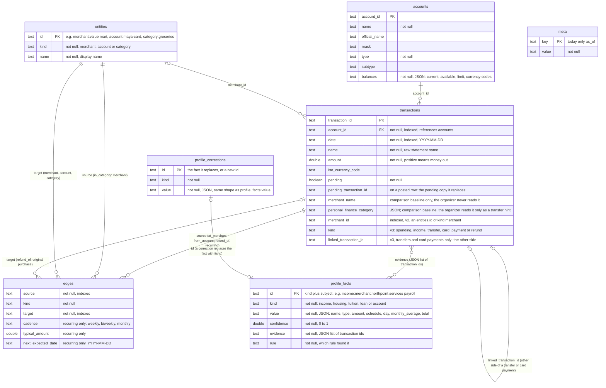

# Sedge database

Taken from the migrations in `Packages/SedgeCore/Sources/SedgeCore/SedgeDatabase.swift`:
`v1` (accounts, transactions, meta), `v2` (the merchant graph: entities, edges and
`transactions.merchant_id`), `v3` (`transactions.kind` and `transactions.linked_transaction_id`)
and `v4` (profile_facts and profile_corrections).

- **accounts** and **transactions** keep Plaid's field names. A transaction belongs to one
  account (the only foreign key SQLite enforces).
- **Pending to posted:** when a charge posts, Plaid sends a new row whose
  `pending_transaction_id` names the pending copy. `save` deletes that pending copy, so the
  link usually points at a row that is gone. It only records which pending copy was replaced.
- **merchant_name** and **personal_finance_category** are Plaid's own cleanup. They are kept
  as the comparison baseline only, and the organizer never reads them, except that transfer
  matching may use the category as a hint. The fake personas leave them empty.
- **meta** holds facts about the dataset. Today that is only `as_of`, the dataset's "today".
- **entities** and **edges** are the merchant graph, rebuilt by `Organizer.organize`.
  `edges.source` and `edges.target` hold either a `transaction_id` or an `entities.id`,
  depending on `kind`, so SQLite doesn't enforce them as foreign keys:

  | kind | source | target |
  |---|---|---|
  | at_merchant | transaction | merchant entity |
  | from_account | transaction | account entity |
  | in_category | merchant entity | category entity |
  | refund_of | refund transaction | the purchase it reverses |
  | recurring | transaction | merchant entity, plus cadence, typical amount, next date |

- **transactions.merchant_id** copies the at_merchant edge so "spending at X" is one indexed
  lookup. With `useGraph` off, every raw name is its own merchant and there are no
  refund_of or recurring edges.
- **transactions.kind** and **linked_transaction_id** are also written by `Organizer.organize`.
  Money leaving one account and the same amount arriving in another of the person's accounts
  within 3 days, with a transfer word in a name (or Plaid's transfer category), is one pair:
  `card_payment` when a credit card is one side, `transfer` otherwise, and each side's
  `linked_transaction_id` names the other. The rest are `spending` (money out), `refund`
  (money in named "REFUND ...") or `income`. With `useReconciliation` off, nothing is paired
  and every row is spending or income by its sign.
- **profile_facts** is rebuilt at the end of `Organizer.organize` (so after every sync) by
  `Profile`, from the merchants, categories, recurring series and kinds above. Transfers and
  card payments are never evidence. **profile_corrections** holds the person's own answers;
  a rebuild never touches it, and a correction always replaces the fact with the same id.

## Database files

Each dataset has its own SQLite file, and every file has the tables above:

- `sedge-<persona>.sqlite` for each fake persona (`sedge-maya.sqlite`, `sedge-daniel.sqlite`,
  `sedge-jordan.sqlite`, `sedge-elena.sqlite`), loaded from `tools/data/<persona>/`.
- One separate bank file for Plaid data (`sedge.sqlite`).

The rule: Plaid data always goes into the bank file and never into a persona's file, and
the app reads the chosen database at launch. Building this is #13's job. Today the app
chooses the file at launch (`-persona <name>` opens that persona's file, otherwise
`sedge.sqlite`), but the Plaid save in `ConnectBankView.swift` still writes to whichever
file is open.
