# Sedge database

Taken from the migrations in `Packages/SedgeCore/Sources/SedgeCore/SedgeDatabase.swift`:
`v1` (accounts, transactions, meta), `v2` (the merchant graph: entities, edges and
`transactions.merchant_id`), `v3` (`transactions.kind` and `transactions.linked_transaction_id`),
`v4` (profile_facts and profile_corrections), `v5` (saved_answers), `v6` (`accounts.owner`,
`transactions.familiar` and `transactions.category_override`), `v7` (`accounts.nickname`) and
`v8` (chats and chat_turns).

```mermaid
erDiagram
    accounts ||--o{ transactions : "account_id"
    transactions |o--o| transactions : "pending_transaction_id (posted to pending copy)"
    transactions |o--o| transactions : "linked_transaction_id (other side of a transfer or card payment)"
    entities |o--o{ transactions : "merchant_id"
    transactions ||--o{ edges : "source (at_merchant, from_account, refund_of, recurring)"
    entities ||--o{ edges : "source (in_category: merchant)"
    entities ||--o{ edges : "target (merchant, account, category)"
    transactions |o--o{ edges : "target (refund_of: original purchase)"
    transactions }o--o{ profile_facts : "evidence (JSON list of transaction ids)"
    profile_corrections |o--o| profile_facts : "id (a correction replaces the fact with its id)"
    chats ||--o{ chat_turns : "chat_id (deleting a chat deletes its turns)"

    accounts {
        text account_id PK
        text name "not null"
        text official_name
        text mask
        text type "not null"
        text subtype
        text balances "not null, JSON: current, available, limit, currency codes"
        text owner "v6, the person's answer: mine or shared, null if not answered"
        text nickname "v7, the person's own name for the account, null if none"
    }

    transactions {
        text transaction_id PK
        text account_id FK "not null, indexed, references accounts"
        text date "not null, indexed, YYYY-MM-DD"
        text name "not null, raw statement name"
        double amount "not null, positive means money out"
        text iso_currency_code
        boolean pending "not null"
        text pending_transaction_id "on a posted row: the pending copy it replaces"
        text merchant_name "comparison baseline only, the organizer never reads it"
        text personal_finance_category "JSON; comparison baseline, the organizer reads it only as a transfer hint"
        text merchant_id "indexed, v2, an entities.id of kind merchant"
        text kind "v3: spending, income, transfer, card_payment or refund"
        text linked_transaction_id "v3, transfers and card payments only: the other side"
        text familiar "v6, the person's answer: yes or not_sure, null if not answered"
        text category_override "v6, a category name the person moved it to, null for the store's category"
    }

    meta {
        text key PK "as_of, or institution_name in the bank file"
        text value "not null"
    }

    entities {
        text id PK "e.g. merchant:value mart, account:maya-card, category:groceries"
        text kind "not null: merchant, account or category"
        text name "not null, display name"
    }

    edges {
        text source "not null, indexed"
        text kind "not null"
        text target "not null, indexed"
        text cadence "recurring only: weekly, biweekly, twice_monthly, monthly"
        double typical_amount "recurring only"
        text next_expected_date "recurring only, YYYY-MM-DD"
    }

    profile_facts {
        text id PK "kind plus subject, e.g. income:merchant:northpoint services payroll"
        text kind "not null: income, housing, tuition, loan or account"
        text value "not null, JSON: name, type, amount, schedule, day, monthly_average, paid, refunded, payments, refunds"
        double confidence "not null, 0 to 1"
        text evidence "not null, JSON list of transaction ids"
        text rule "not null, which rule found it"
    }

    profile_corrections {
        text id PK "the fact it replaces, or a new id"
        text kind "not null"
        text value "not null, JSON, same shape as profile_facts.value"
    }

    saved_answers {
        text fact_key PK "snake_case fact the model asked about, e.g. food_definition"
        text question "not null, the question as asked"
        text answer "not null, the reply the person tapped"
        text date "not null, the dataset's as_of when it was answered"
    }

    chats {
        integer id PK "auto-incremented"
        text title "not null, the first question, shortened"
        datetime created "not null, clock time the chat started, stored but not shown"
        datetime updated "not null, clock time of the last saved turn, a label and the list's order"
    }

    chat_turns {
        integer id PK "auto-incremented, also the turns' order"
        integer chat_id FK "not null, indexed, references chats, on delete cascade"
        text question "not null, as the person typed it"
        text answer "JSON: the Ask screen's answer, null if none came"
    }
```

- **accounts** and **transactions** keep Plaid's field names. A transaction belongs to one
  account (one of the two foreign keys SQLite enforces; the other is `chat_turns.chat_id`).
- **Pending to posted:** when a charge posts, Plaid sends a new row whose
  `pending_transaction_id` names the pending copy. `save` deletes that pending copy, so the
  link usually points at a row that is gone. It only records which pending copy was replaced.
- **merchant_name** and **personal_finance_category** are Plaid's own cleanup. They are kept
  as the comparison baseline only, and the organizer never reads them, except that transfer
  matching may use the category as a hint. The fake personas leave them empty.
- **meta** holds facts about the dataset: `as_of`, the dataset's "today", and in the bank file
  only, `institution_name`, the connected bank's name from Plaid Link (one file, one connection).
- **entities** and **edges** are the merchant graph, rebuilt by `Organizer.organize`.
  `edges.source` and `edges.target` hold either a `transaction_id` or an `entities.id`,
  depending on `kind`, so SQLite doesn't enforce them as foreign keys:

  | kind | source | target |
  |---|---|---|
  | at_merchant | transaction | merchant entity |
  | from_account | transaction | account entity |
  | in_category | merchant entity | category entity |
  | refund_of | refund transaction | the purchase it reverses |
  | recurring | transaction | merchant entity, plus cadence, typical amount, next date |

- **transactions.merchant_id** copies the at_merchant edge so "spending at X" is one indexed
  lookup. With `useGraph` off, every raw name is its own merchant and there are no
  refund_of or recurring edges.
- **transactions.kind** and **linked_transaction_id** are also written by `Organizer.organize`.
  Money leaving one account and the same amount arriving in another of the person's accounts
  within 3 days, with a transfer word in a name (or Plaid's transfer or card-payment category),
  is one pair: `card_payment` when a credit card is one side, `transfer` otherwise, and each
  side's `linked_transaction_id` names the other. The rest are `spending` (money out), `refund`
  (money in named "REFUND ...", or ending in "REFUND" and no more than what was paid at the
  store; the full rule is in `docs/assumptions.md`) or `income`. With `useReconciliation` off,
  nothing is paired and every row is spending or income by its sign.
- **profile_facts** is rebuilt at the end of `Organizer.organize` (so after every sync) by
  `Profile`, from the merchants, categories, recurring series and kinds above. Transfers,
  card payments and pending charges are never evidence. **profile_corrections** holds the
  person's own answers; a rebuild never touches it, and a correction always replaces the fact
  with the same id.
- **saved_answers** holds the person's replies to `ask_user`, one per `fact_key`, so a
  clarifying question is asked only once. Before asking, `ask_user` checks this table and
  then profile_corrections (a correction whose kind starts the key, e.g. `housing` for
  `housing_type`, or whose id in key form, `factKey(id)`, is the key: lowercased, with each run of non-letters/digits
  turned into `_` between words and dropped at the ends). Nothing rebuilds the table; the Saved answers
  screen changes or removes one answer, and the Accounts screen's "Reset saved questions"
  clears it.
- **accounts.owner**, **transactions.familiar** and **transactions.category_override** are the
  person's answers about one account or transaction, set and cleared by `Answers`. A category
  belongs to a store (its in_category edge); `category_override` moves one transaction to
  another category wherever spending is split by category (the tools' category input and the
  Spending and All months screens). Like merchant_id they aren't part of `Account` or
  `Transaction`, so reloading the data or organizing again keeps them. A pending charge's
  answers stay with the pending row, so they are dropped when it posts under a new id.
- **accounts.nickname** is the person's own name for an account, typed in the account check
  and saved by `Answers.setNickname` (a blank name is stored as null). The app's screens show
  it in place of `name`; the tools keep reporting `name`. Like `owner`, reloading the data or a
  bank sync keeps it.
- **chats** and **chat_turns** are the Ask screen's saved chats (`Chats`), listed in Previous
  chats and reopened for display. A turn is saved once its answer is in (or the chat hit its
  limit); continuing an older chat adds turns to it. They live in the open dataset's file, so
  each persona and the bank file keep their own chats, and reloading the data or organizing
  again leaves them alone. Their times come from the clock and no data logic reads them: `updated`
  labels and orders the list, and `created` is stored but not shown. Nothing hands saved turns to
  whatever answers questions.

## Database files

Each dataset has its own SQLite file, and every file has the tables above:

- `sedge-<persona>.sqlite` for each fake persona (`sedge-maya.sqlite`, `sedge-daniel.sqlite`,
  `sedge-jordan.sqlite`, `sedge-elena.sqlite`), loaded from `tools/data/<persona>/`.
- One separate bank file for Plaid data (`sedge.sqlite`). Debug builds launched with
  `-emptyBank YES` (UI tests) use `sedge-empty-bank.sqlite` instead, a bank file that never syncs.

The rule: Plaid data always goes into the bank file and never into a persona's file, and
the app reads the chosen database at launch. The data picker remembers the choice (a
persona's name or `bank`), and launching with `-persona <name>` picks that persona too.
Opening a persona's file reloads it from the bundled fake data (so its `as_of` stays
2026-06-30); the bank file keeps what the last sync saved. Either way the organizer runs
again on open. Only the bank file is ever handed to the Plaid flow
in `ConnectBankView.swift`, so a sync can't write into a persona's file.
